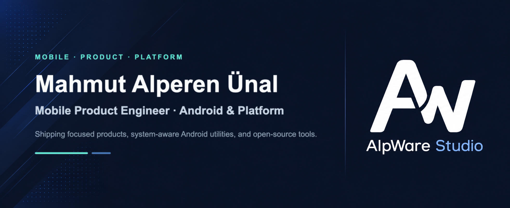
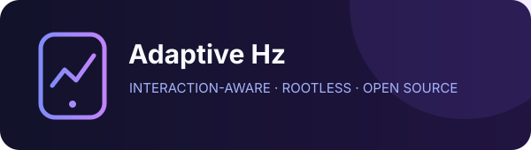
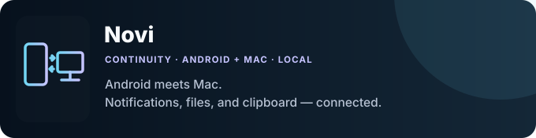
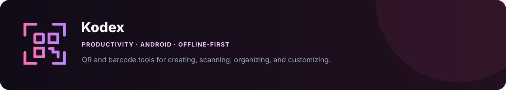
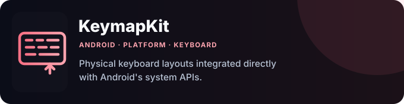
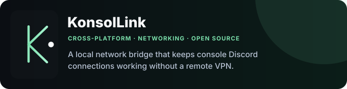

  

   

  <a href="https://mahmutalperenunal.com"><strong>Website</strong></a>
  &nbsp;·&nbsp;
  <a href="https://www.alpwarestudio.com"><strong>AlpWare Studio</strong></a>
  &nbsp;·&nbsp;
  <a href="https://play.google.com/store/apps/dev?id=5245599652065968716"><strong>Google Play</strong></a>
  &nbsp;·&nbsp;
  <a href="https://apps.apple.com/us/developer/mahmut-alperen-unal/id6795194022"><strong>App Store</strong></a>
  &nbsp;·&nbsp;
  <a href="https://www.linkedin.com/in/mahmut-alperen-unal/"><strong>LinkedIn</strong></a>

 

I build and ship mobile products with a strong focus on **mobile**, **privacy-conscious architecture**, **offline-first experiences**, and **platform-level tooling** — from product idea and interface to release and long-term maintenance.

My work sits between product engineering and the Android platform: polished end-user apps on one side, system-aware utilities and open-source experiments on the other.

<table>
  <tr>
    <td width="33%" valign="top">
      <strong>Mobile products</strong>  
      Production applications built with Kotlin, Jetpack Compose, and Flutter.
    </td>
    <td width="33%" valign="top">
      <strong>Android systems</strong>  
      Utilities that work carefully with platform services, permissions, and device behavior.
    </td>
    <td width="33%" valign="top">
      <strong>Open development</strong>  
      Source code, engineering decisions, documentation, and community-ready projects.
    </td>
  </tr>
</table>

## Featured works

<table>
  <tr>
    <td width="50%" valign="top">
      
        
      A rootless Android utility that adapts display refresh rate to real interaction while respecting device-specific behavior.
        
      <a href="https://github.com/mahmutaunal/Adaptive-Hz"><strong>Source code →</strong></a>
    </td>
    <td width="50%" valign="top">
      
        
      An offline-first encrypted vault for passwords, private records, attachments, backups, and secure everyday access.
        
      <a href="https://play.google.com/store/apps/details?id=com.mahmutalperenunal.passwordsbook"><strong>Google Play →</strong></a>
    </td>
  </tr>
  <tr>
    <td width="50%" valign="top">
      
        
      Your Android phone, connected to your Mac. Notifications, files, and clipboard sharing over an encrypted local connection.
        
      <a href="https://play.google.com/store/apps/details?id=com.alpware.notifybridge"><strong>Google Play →</strong></a>
      &nbsp;·&nbsp;
      <a href="https://apps.apple.com/us/app/novi-phone-companion/id6795194020?mt=12"><strong>Mac App Store →</strong></a>
    </td>
    <td width="50%" valign="top">
      
        
      A modern QR and barcode toolkit for scanning, creation, customization, organization, and secure offline use.
        
      <a href="https://play.google.com/store/apps/details?id=com.mahmutalperenunal.kodex"><strong>Google Play →</strong></a>
    </td>
  </tr>
  <tr>
    <td width="50%" valign="top">
      
        
      System-level physical keyboard layouts for Android, integrated through the platform layout provider instead of a custom IME.
        
      <a href="https://play.google.com/store/apps/details?id=com.alpware.keymapkit"><strong>Google Play →</strong></a>
    </td>
    <td width="50%" valign="top">
      
        
      A cross-platform local network bridge for console Discord connections on macOS, Windows, and Linux.
        
      <a href="https://github.com/mahmutaunal/KonsolLink"><strong>Source code →</strong></a>
    </td>
  </tr>
</table>

## More works

| Project | Built for | Availability |
| --- | --- | --- |
| **Score Book** | Offline scorekeeping, game history, player statistics, and local backup | [Google Play](https://play.google.com/store/apps/details?id=com.mahmutalperenunal.skordefteri) · [App Store](https://apps.apple.com/app/score-book-game-counter/id6795472075 ) |
| **Wakeon** | Cross-platform Wake-on-LAN device management | [Google Play](https://play.google.com/store/apps/details?id=com.alpwarestudio.wakeon) · [App Store](https://apps.apple.com/us/app/wakeon-wake-on-lan/id6813891781) · [Source](https://github.com/mahmutaunal/Wakeon) |
| **WiSense** | On-device Wi-Fi analysis to find better channels and reduce interference | [Google Play](https://play.google.com/store/apps/details?id=com.mahmutalperenunal.channelsense) |
| **Frekio** | Private internet radio, from your phone to Android Auto and CarPlay | [Source](https://github.com/mahmutaunal/Frekio) |
| **DarkSwitch** | Experimental per-app dark mode for Android, powered by Shizuku without root | [Source](https://github.com/mahmutaunal/DarkSwitch) |
| **ChargeFreeze** | Pause Android charging while keeping Android Auto, DeX, and USB connections active | [Source](https://github.com/mahmutaunal/ChargeFreeze) |
| **ScaleLink** | Sync supported Bluetooth smart scales directly to Android Health Connect | [Source](https://github.com/mahmutaunal/ScaleLink) |
| **LeadMailFinder** | Find companies and contact emails for job searches and B2B outreach | [Source](https://github.com/mahmutaunal/leadmail-finder) |
| **TVPilot** | Control Android TV and Google TV apps and system settings with your remote | [Source](https://github.com/mahmutaunal/TVPilot) |
| **Play Store Launcher** | Open the hidden Google Play Store on Android TV with one tap | [Source](https://github.com/mahmutaunal/Play-Store-Launcher) |
| **Zapret macOS Discord** | Set up Zapret for Discord on Apple Silicon Macs with one command | [Source](https://github.com/mahmutaunal/zapret-macos-discord) |

## How I build

> **Privacy-first** — collect less, keep sensitive work on-device, and explain network behavior clearly.

> **Offline-first** — keep core experiences useful without requiring a permanent connection.

> **Platform-aware** — use native capabilities when they create a more reliable and coherent product.

> **Long-term** — treat publishing as the beginning of maintenance, not the end of development.

## Working stack

`Kotlin` &nbsp; `Jetpack Compose` &nbsp; `Coroutines` &nbsp; `Flow` &nbsp; `Room` &nbsp; `WorkManager`  
`Shizuku` &nbsp; `Android System APIs` &nbsp; `Android Keystore` &nbsp; `Biometrics` &nbsp; `Play Integrity`  
`Flutter` &nbsp; `Dart` &nbsp; `SwiftUI` &nbsp; `Firebase` &nbsp; `Networking` &nbsp; `Shell`

## AlpWare Studio

I build and publish my independent products under **[AlpWare Studio](https://www.alpwarestudio.com)** — focused on useful, understandable software shaped by privacy, simplicity, platform conventions, and long-term maintainability.

 

  <a href="https://github.com/mahmutaunal?tab=repositories"><strong>Explore repositories</strong></a>
  &nbsp;·&nbsp;
  <a href="https://play.google.com/store/apps/dev?id=5245599652065968716"><strong>View published apps on Google Play</strong></a>
  &nbsp;·&nbsp;
  <a href="https://apps.apple.com/us/developer/mahmut-alperen-unal/id6795194022"><strong>View published apps on App Store</strong></a>

